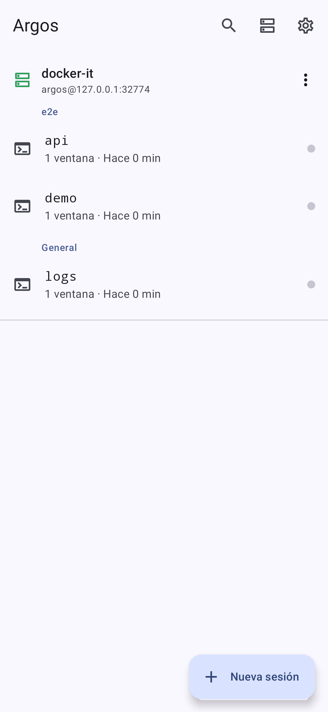
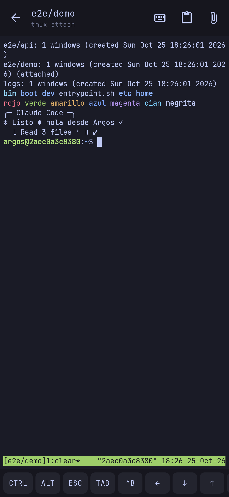
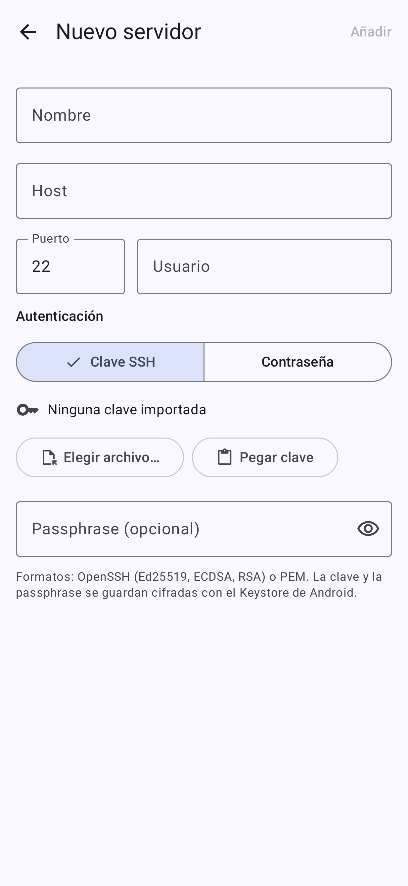
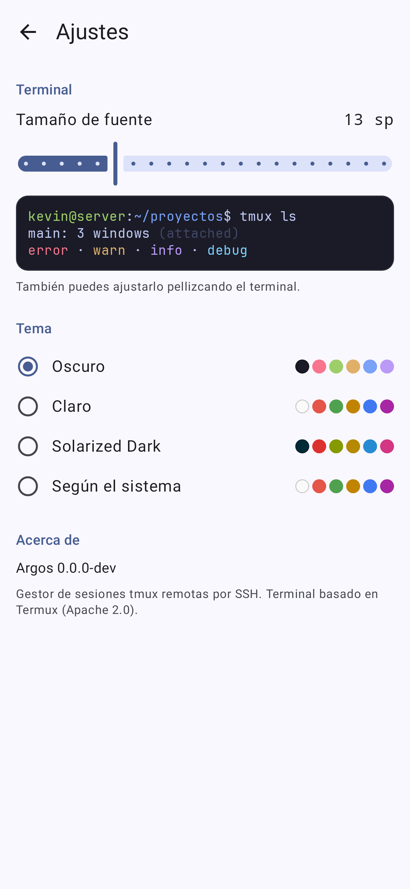

# Argos para Android

**Gestor de sesiones [tmux](https://github.com/tmux/tmux) remotas vía SSH**, para Android. Es el port de [Argos](https://github.com/victalejo/Argos) (macOS/SwiftUI) a Kotlin + Jetpack Compose.

Se conecta a tus servidores por SSH, garantiza que tmux esté instalado y configurado, lista las sesiones de cada servidor y abre un **terminal en vivo** (`tmux attach`) sobre un PTY remoto. Puedes crear, renombrar y matar sesiones sin salir de la app.

<p align="center">
  
  
  
  
</p>

## Instalar

1. Descarga el `Argos-x.y.z.apk` del último [Release](https://github.com/AloreBB/argos-android/releases/latest).
2. Ábrelo en el teléfono. Android te pedirá permitir **instalar apps de origen desconocido** para tu navegador o gestor de archivos. Acéptalo solo para esta instalación.
3. Las actualizaciones se instalan encima (todas las versiones van firmadas con la misma clave).

Requiere **Android 8.0+** (API 26).

## Características

- **Multi-servidor**: añade, edita y borra servidores. Se guardan en el almacenamiento privado de la app, sin servidores hardcodeados.
- **Autenticación por clave o contraseña**: claves OpenSSH (Ed25519, ECDSA, RSA) o PEM, con passphrase opcional. Importas la clave desde un archivo o la pegas. También funciona usuario + contraseña (incluye *keyboard-interactive*). La clave, la passphrase y la contraseña se guardan **cifradas con AES-256-GCM** usando una clave no exportable del **Android Keystore**.
- **Host key TOFU** (*Trust-On-First-Use*): en la primera conexión se guarda la huella `SHA256:…` y su tipo, y las siguientes se validan contra ella. Si cambia, la conexión se aborta (protección contra MitM). Para resetearla: menú del servidor → **Olvidar host key**.
- **Bootstrap automático de tmux**: detecta tmux. Si falta y hay `sudo` sin contraseña, lo instala con `apt`. Crea un `~/.tmux.conf` base (mouse, scrollback, truecolor, OSC 52) si no existe. Es idempotente y no interactivo: la app nunca pide ni guarda la contraseña de `sudo`.
- **Sesiones agrupadas**: el prefijo antes del primer `/` define el grupo (`magic-agents/backend` → *magic-agents*). Las que no tienen `/` caen en *General*. Incluye búsqueda sin distinguir mayúsculas ni tildes, y *pull-to-refresh*.
- **Terminal en vivo**: PTY sobre SSH con `tmux -u attach` (UTF-8 forzado). Se renderiza con el emulador de [Termux](https://github.com/termux/termux-app) (colores, mouse de tmux, selección y copia, pellizco para cambiar el tamaño de fuente).
- **Fila de teclas extra**: `CTRL`/`ALT` (de un solo uso), `ESC`, `TAB`, `^B` (prefijo de tmux), flechas, `PGUP`/`PGDN`, `HOME`/`END`, `- / | ~`.
- **Portapapeles OSC 52**: lo que copian tmux o las apps remotas (p. ej. Claude Code) llega al portapapeles de Android. Nunca en silencio: cada copia remota se avisa y tiene un tope de 100 000 caracteres.
- **Enlaces**: toca una URL o un enlace OSC 8 (p. ej. los de PR o rama de Claude Code) para abrirlo en el navegador. Con mouse, **Ctrl/Cmd + clic**. Solo se abren `http`/`https`. Si tu `~/.tmux.conf` ya existía, agrega `set -as terminal-features ",*:hyperlinks"` (tmux 3.4+) para que tmux deje pasar los OSC 8.
- **Subir archivos e imágenes**: el botón 📎 sube archivos por SFTP a `/tmp/argos-<ts>-<token>-<nombre>` y escribe la ruta en el terminal. **Pegar** con una imagen en el portapapeles la sube a `/tmp/argos-pasted-<ts>-<token>.png`, útil para pasarle capturas a Claude Code. Los archivos se crean en exclusiva (nunca siguen un symlink preexistente) con permisos `0600`.
- **Detach, no kill**: salir del terminal hace *detach* y la sesión tmux sigue viva en el servidor.
- **Reconexión automática**: si se cae la red, reintenta con backoff exponencial (1, 2, 4, 8 y 16 s, hasta 5 intentos). Los errores no transitorios (clave inválida, credenciales rechazadas, host key cambiada) no se reintentan.
- **Temas**: Sistema, Oscuro, Claro y Solarized Dark.

> El bootstrap de tmux asume Ubuntu/Debian (`apt`). En otras distros instala tmux a mano.

## Compilar

Requisitos: JDK 21 y el Android SDK (compileSdk 37). El SDK se descarga solo si aceptaste las licencias.

```bash
./gradlew :app:assembleDebug          # APK debug en app/build/outputs/apk/debug/
./gradlew :app:testDebugUnitTest      # tests unitarios + Robolectric
./gradlew :app:lintDebug
```

### Tests de integración (SSH real)

`it/run-integration.sh` levanta un `sshd` desechable en Docker, enlazado **solo a 127.0.0.1** en un puerto aleatorio y sin tmux preinstalado. Las claves, la passphrase y la contraseña de prueba se generan aleatoriamente en cada corrida; el repo no tiene credenciales. Contra ese servidor corre:

- `SshServiceIntegrationTest`: bootstrap (instalación con `sudo -n apt`, instrucción manual sin sudo), CRUD de sesiones con *quoting* hostil, auth por clave, por passphrase y por contraseña, TOFU (detección de cambio y "olvidar"), SFTP y PTY (tecleo, UTF-8, window-change, detach sin matar, EOF al hacer detach).
- `AppEndToEndTest`: la UI real (Compose + `TerminalView`) en Robolectric. Lista sesiones, abre el terminal, verifica la salida en el emulador, vuelve atrás (detach) y guarda capturas en `app/build/screenshots/`.

```bash
./it/run-integration.sh
```

La CI ejecuta todo lo anterior en cada push.

## Arquitectura

```
:terminal  Termux terminal-emulator + terminal-view (vendorizado, Apache 2.0)
           TerminalSession reescrita: sin JNI, alimentada por un Transport remoto
:app
  model/   TmuxSession, SessionGrouping, SessionNameValidator, ShellQuoting, Server   (lógica pura)
  ssh/     SshService (sshj: conexión compartida, comandos, bootstrap, CRUD, SFTP, PTY)
           KnownHostsStore + TofuHostKeyVerifier, TmuxOutput, SshError (mensajes de UI)
  data/    ServerStore (servers.json), SecretStore (Keystore AES-GCM), TerminalSettings
  ui/      SessionsViewModel + SessionLoader (estados de bootstrap), SessionsScreen,
           ServerFormScreen, SessionNameDialog, TerminalViewModel + TerminalScreen, Settings
```

- **Una conexión SSH por servidor** (`SshService`), compartida entre la lista y el terminal. Los comandos, el SFTP y el PTY son canales multiplexados. Si la conexión se cae, se recrea bajo demanda.
- **El `TerminalViewModel` es dueño de la sesión del terminal y del canal PTY**, así que la conexión sobrevive a rotaciones. La vista solo se engancha.
- La I/O de sshj es bloqueante: corre en `Dispatchers.IO`, y la lectura del PTY va en un hilo propio que se desbloquea al cerrar el canal.

## Seguridad

- Los secretos nunca van en texto plano ni en `servers.json`: se cifran con una clave del Android Keystore. No se hacen backups (`allowBackup=false` + `dataExtractionRules`), porque esos secretos no se podrían descifrar en otro dispositivo.
- Host key TOFU, en lugar de aceptar cualquier clave.
- Anti-inyección: los nombres de sesión se validan (`:` `.`, caracteres de control y `-` inicial) y se entrecomillan en POSIX antes de llegar al shell. Los nombres de archivos subidos se sanean a `[A-Za-z0-9._-]`.
- `sudo -n`: la app nunca bloquea pidiendo contraseña ni la guarda.

## Publicar una versión

Es automático. Cada push a `main` (incluido el merge de un PR) corre [semantic-release](https://semantic-release.gitbook.io/) (`.releaserc.json`). Este revisa los commits desde el último tag `vX.Y.Z` y decide la versión con [Conventional Commits](https://www.conventionalcommits.org/):

| Commits | Versión |
|---|---|
| `tipo!:` o footer `BREAKING CHANGE:` | major (`2.0.0`) |
| `feat` | minor (`1.4.0`) |
| `fix` o `perf` | patch (`1.3.1`) |
| solo `docs`, `ci`, `test`, `chore`… | no publica |

Si toca publicar, actualiza el [`CHANGELOG.md`](CHANGELOG.md) y lo commitea como `chore(release): X.Y.Z [skip ci]`. Luego compila y firma el APK con `scripts/build-release-apk.sh`, usando la clave de release de los secrets `ARGOS_KEYSTORE_BASE64`, `ARGOS_KEYSTORE_PASSWORD`, `ARGOS_KEY_ALIAS` y `ARGOS_KEY_PASSWORD`. Antes de publicar verifica que el APK no esté firmado con la clave debug. Al final crea el tag y el GitHub Release con las notas agrupadas en Novedades, Correcciones y Rendimiento, junto a `Argos-X.Y.Z.apk` y su SHA-256.

## Licencia

[Apache 2.0](LICENSE). Incluye código de Termux (Apache 2.0); ver [NOTICE](NOTICE).
